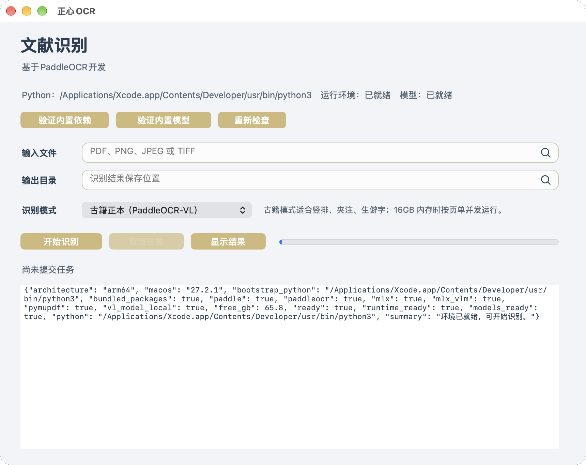

# 正心OCR

正心OCR 是一款以本机 OCR 为核心的文档识别工具，面向普通扫描件、复杂版式文档和中文古籍影像。

项目提供 macOS 与 Windows 客户端。



## 功能

- 支持普通扫描识别、复杂版面解析，以及竖排、夹注、生僻字等古籍影像识别；各客户端可用模式因系统和运行环境而异。
- macOS 通用版可在 Intel 与 Apple Silicon Mac 上启动，并根据芯片提供相应的 OCR 模式。
- Windows 客户端提供首次运行时准备 Python、依赖和模型的安装流程。
- 支持通过图形界面、命令行及 STDIO MCP 使用识别后端。
- 支持输入CAJ、PDF、EPUB、MOBI、AZW3、DOCX等文件或PNG、JPEG、TIFF等图片。
- 输出MD文件。
- 识别任务和输出在本机处理；模型或运行依赖可能需要在首次准备时下载。

## 下载

| 客户端 | 支持范围 | 源码目录 | 状态 |
| --- | --- | --- | --- |
| macOS 通用安装版 | Intel 与 Apple Silicon；模式能力依芯片而异 | `work/ZhengxinOCRUniversal/` | 版本 1.0.1 |
| macOS 完整离线版 | Apple Silicon，macOS 26 或更高版本 | `work/AncientOCR/` | 版本 1.0.1 |
| Windows | Windows 11 x64 | `work/ZhengxinOCRWindows/` | 版本 1.0.1 测试候选 |

通用版及 Windows 版会在首次运行时准备相应运行依赖或模型，完整离线版随安装包携带依赖和模型。

正式安装包可从本项目的 GitHub **Releases** 页面获取。

## 从源码构建

```text
work/AncientOCR/             Apple Silicon macOS 完整离线版
work/ZhengxinOCRUniversal/   Intel 与 Apple Silicon macOS 通用版
work/ZhengxinOCRWindows/     Windows WPF 客户端、后端适配和安装器
work/Shared/                 macOS 客户端共享组件
work/PaddleOCR/              PaddleOCR 上游源码快照（Apache-2.0）
```

macOS 完整离线版需要 Apple Silicon Mac、Xcode Command Line Tools、本机 Python 3.13 和网络连接。准备步骤会下载约数 GB 的 Python 依赖与 OCR 模型。进入 `work/AncientOCR/` 后运行：

```sh
python3 prepare_bundle.py
./build.sh
```

macOS 通用版需要 macOS、Xcode 及 `actool`。进入 `work/ZhengxinOCRUniversal/` 后运行：

```sh
./build.sh
```

Windows 客户端可在 Windows 开发环境中运行 `build.ps1`，或在具备 Python 3、.NET 8 SDK 和网络的环境中运行：

```sh
python3 build.py --dotnet /path/to/dotnet
```

## 第三方组件与许可

本项目原创客户端源码按 GNU GPL-3.0-or-later 授权，详见 [LICENSE](LICENSE)。

`work/PaddleOCR/` 是 PaddleOCR 上游源码快照，继续按该目录中的 Apache License 2.0 及其版权声明提供。

应用还使用了 PaddlePaddle、MLX-VLM、.NET、uv 、caj2pdf-rust 等第三方组件。

使用、修改或再分发时，请同时遵守各组件及模型的许可和上游条款。
